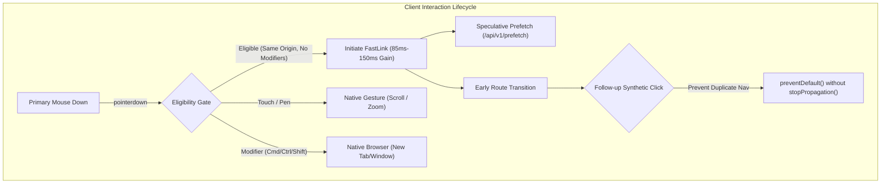

# fast-link

[](https://skills.sh)
[](LICENSE)
[](#security)
[](#evals)

Universal agentic skill providing technical specifications, architecture patterns, and automated verification suites for **FastLink** — the early pointerdown navigation and speculative prefetching engine that recovers 85ms–150ms of human hold latency across any web project.

---

## Architecture Overview



---

## Operating Modes

| Mode | Target Stack | Integration Path | Reference Document |
|---|---|---|---|
| **SCRIPT** | Static sites, Hugo, Astro, CDN | Embed `<script src="/fastlink.min.js" defer></script>` | [architecture.md](references/architecture.md) |
| **PROXY** | Go, Rust, Django, Rails, Laravel, MPA | Deploy streaming reverse proxy with auto HTML injection | [architecture.md](references/architecture.md) |
| **SPA** | Next.js, Remix, SvelteKit, Nuxt | Mount `window.__FAST_LINK_NAVIGATE__` router hook | [architecture.md](references/architecture.md) |
| **VERIFY** | Any web architecture | Run automated invariant test suite and config validation | [gesture-safety.md](references/gesture-safety.md) |

---

## Inviolable Safety Invariants

1. **Touch & Stylus Rejection**: Must enforce `event.pointerType === 'mouse'`. Mobile touch gestures and momentum scrolling are never intercepted.
2. **Modifier Passthrough**: Must ignore events when `event.button !== 0` or `metaKey`, `ctrlKey`, `shiftKey`, `altKey` are active.
3. **Keyboard Accessibility**: Must never suppress click events where `event.detail === 0` (Enter key or screen reader activation).
4. **Non-Destructive Click Suppression**: Must call `event.preventDefault()` on synthetic clicks to stop double navigation; must NEVER call `event.stopPropagation()` so analytics observers continue receiving click events.
5. **Drag-Away Abort Handling**: Must detect cursor release outside target anchor and abort pending navigation.
6. **Boundary Encapsulation**: Strictly respects `data-no-fast-link`, `role="button"`, `target="_blank"`, and `download`.

---

## CLI & Automated Tooling

Run the deterministic CLI utilities included with the skill:

```bash
# Validate fastlink.config.json against JSON schema
./bin/cli.js validate

# Run the 18-point gesture safety and invariant test suite
./bin/cli.js verify

# Run eval-harness capability and regression checks
./bin/cli.js eval

# Run baseline failure demonstration
./bin/cli.js demo
```

---

## Installation Across Agent Environments

### Agent Environments
Add to your agent configuration:
```bash
git clone https://github.com/imMamdouhaboammar/fast-link.git ~/.agents/skills/fast-link
```

### Universal Shell Installer
```bash
curl -fsSL https://raw.githubusercontent.com/imMamdouhaboammar/fast-link/main/install.sh | bash
```

---

## Security & Eval Gates

- **Security Scan**: `APPROVE` (Risk Score: 0/100, 0 High/Critical findings via OmniSkill Security Scanner).
- **Capability Evals**: 5/5 passed (`pass@3: 100%`).
- **Regression Evals**: 2/2 passed (`pass^3: 100%`).
