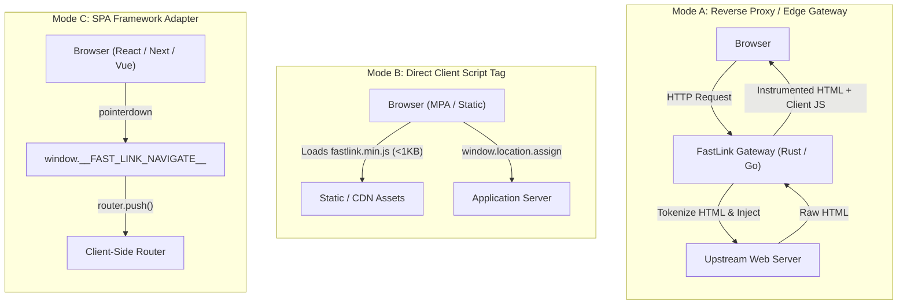

# FastLink Architecture & Integration Modes

FastLink accelerates web navigation by capturing the human mouse press-to-release interval (~85ms to 150ms). Navigation and speculative prefetching initiate on primary mouse `pointerdown` rather than waiting for the `click` event.

---

## The Three Architecture Modes

FastLink supports three primary integration modes depending on the host project architecture:



---

## Mode A: Reverse Proxy / Edge Gateway (Zero Frontend Edits)

### Target Use Case
Multi-page applications (Go, Rust, Python Django/FastAPI, Ruby on Rails, PHP Laravel/WordPress) or distributed micro-frontends where modifying application source code is impractical or prohibited.

### Mechanics
1. FastLink operates as a high-throughput HTTP reverse proxy in front of the upstream web application.
2. The proxy intercepts `text/html` responses and passes them through a streaming HTML rewriter (`HtmlRewriter`).
3. Anchors (`<a>`) matching same-origin criteria are tagged with `data-fast-link="true"`.
4. The client runtime script (`<script src="/fastlink.min.js" defer></script>`) is automatically injected immediately preceding the closing `</body>` tag.
5. Upstream headers (including `Content-Length`, `ETag`, and compression) are safely adjusted.

---

## Mode B: Direct Client Script Injection (<1KB)

### Target Use Case
Static site generators (Astro, Hugo, 11ty), CDN-hosted storefronts, or traditional server-rendered templates where inserting a single `<script>` tag is straightforward.

### Mechanics
1. Host `fastlink.min.js` at a public path (e.g. `/fastlink.min.js`).
2. Include the script tag in the root layout or `<head>` / `<body>`:
   ```html
   <script src="/fastlink.min.js" defer></script>
   ```
3. The script automatically initializes once (`window.__FAST_LINK_INITIALIZED__`), registers capturing listeners on `document`, and handles early navigation via `window.location.assign`.

---

## Mode C: Modern SPA Framework Adapter

### Target Use Case
Client-side routed single page applications and SSR meta-frameworks:
- Next.js (App Router / Pages Router)
- Remix / React Router
- SvelteKit
- Nuxt / Vue Router

### Mechanics
FastLink exposes a global navigation hook `window.__FAST_LINK_NAVIGATE__`. When defined, FastLink delegates the resolved intent to the SPA router rather than triggering full document location replacement:

```typescript
// Next.js (App Router) Integration Example
'use client';
import { useEffect } from 'react';
import { useRouter } from 'next/navigation';

export function FastLinkAdapter() {
  const router = useRouter();

  useEffect(() => {
    // Bind FastLink navigation hook to Next.js App Router
    window.__FAST_LINK_NAVIGATE__ = (intent) => {
      router.push(intent.url.pathname + intent.url.search + intent.url.hash);
    };

    return () => {
      delete window.__FAST_LINK_NAVIGATE__;
    };
  }, [router]);

  return null;
}
```
